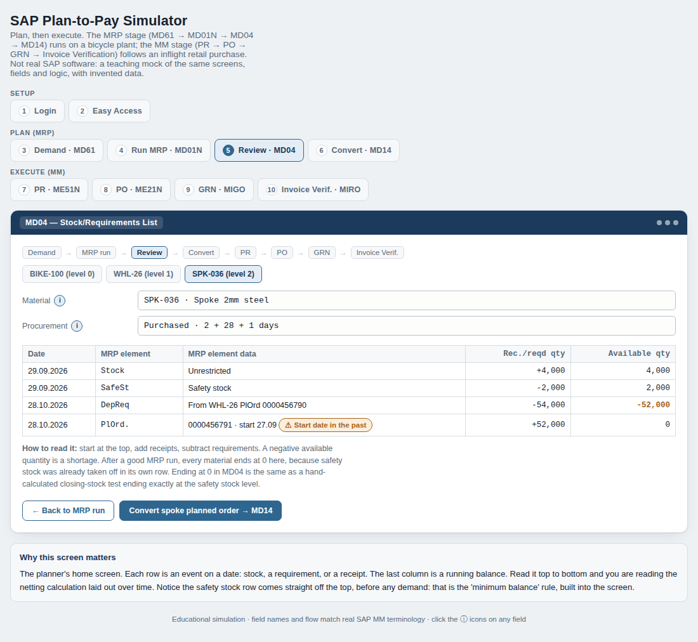

# SAP Plan-to-Pay Simulator

An interactive, browser-based walkthrough of how SAP plans a purchase and then pays for it: from a demand number entered by a planner, through MRP, all the way to a vendor invoice.

**Live demo:** https://naveen106-tr.github.io/sap-mrp-p2p-simulator/



> This is not SAP software. It is a teaching mock of real SAP S/4HANA screens, fields and logic, built with invented data (a bicycle plant for MRP and an inflight retail purchase for procure-to-pay).

---

## Why I built it

As a supply chain analyst I worked hands-on with the procure-to-pay cycle every week: raising purchase requisitions and purchase orders, receiving goods, moving stock between hubs and resolving invoice mismatches. I also did the planning maths behind MRP myself, in Excel: how much to order after stock and open orders, when to order given supplier lead times, and how much buffer to keep.

What I wanted was the **logic underneath the screens**: why SAP asks for each field, what it calculates on its own, and what breaks when the data behind it is wrong. So I rebuilt the whole chain from first principles and turned it into something you can click through.

---

## What it covers

### 1. Plan (MRP)
| Step | Transaction | What happens |
|---|---|---|
| Demand | **MD61** | The S&OP-agreed forecast (1,000 bicycles) is entered as a Planned Independent Requirement. Only finished goods get forecasts. |
| MRP run | **MD01N** (MRP Live) | SAP nets, explodes the bill of materials, and schedules in one pass. |
| Review | **MD04** | The planner's home screen: a date-by-date running balance with exception messages. |
| Convert | **MD14** | A planned order (MRP's pencil draft) becomes a firm purchase requisition. |

**The worked example: how one bicycle order becomes 52,000 spokes**
```
Bicycle   1,000 needed − 200 in stock                     =    800 to build
Wheels    800 × 2 = 1,600 − 100 in stock                  =  1,500 to build
Spokes    1,500 × 36 = 54,000 − (4,000 on hand − 2,000 safety stock) = 52,000 to buy
```
Three rules the simulator makes visible:
- **Net before you explode.** Components are calculated from the parent's *net* requirement, never the gross.
- **Safety stock is a minimum balance.** It is subtracted from available stock, so a correct plan ends at exactly the safety-stock level (0 "available" in MD04).
- **Plan backwards from the need date.** Lead time is split into buyer, supplier and goods-receipt time. When the calculated start date is already in the past, SAP still creates the order and raises an exception for the planner to act on.

### 2. Execute (procure-to-pay)
| Step | Transaction | What happens |
|---|---|---|
| Purchase requisition | **ME51N** | Internal request: plant and storage location are mandatory. |
| Purchase order | **ME21N** | Binding order to a vendor; company code (the paying legal entity) appears for the first time. |
| Goods receipt | **MIGO** (movement type 101) | Stock becomes real; quantities are checked against the PO. |
| Invoice verification | **MIRO** | Three-way match of PO, goods receipt and invoice, with tolerance limits and a price-variance block. |

Every field has an ⓘ explanation of *why* it exists.

---

## How to use it
1. Open the live demo.
2. Go to **Review · MD04** *before* running MRP and look at the shortage.
3. Run MRP in **MD01N**, then switch between the three materials in MD04 (level 0, 1, 2).
4. Convert the spoke order in **MD14** and follow it through PR → PO → GRN → MIRO.

## Built with
Plain HTML, CSS and JavaScript in a single file. No frameworks, no data leaves your browser.

## Related work
- [Beverage demand forecasting portfolio](https://github.com/Naveen106-tr/Beverage-demand-forecasting): SARIMA forecasting, Power BI S&OP dashboard, ABC-XYZ segmentation, excess-stock analysis, forecast bias analysis.

---
*Naveen Thrikoshery Radhakrishnan · Supply Chain Analyst · [LinkedIn](https://www.linkedin.com/in/naveenradhakrishnan/)*
